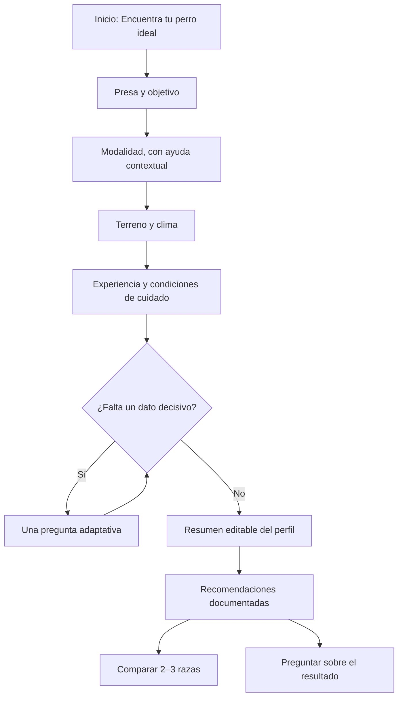
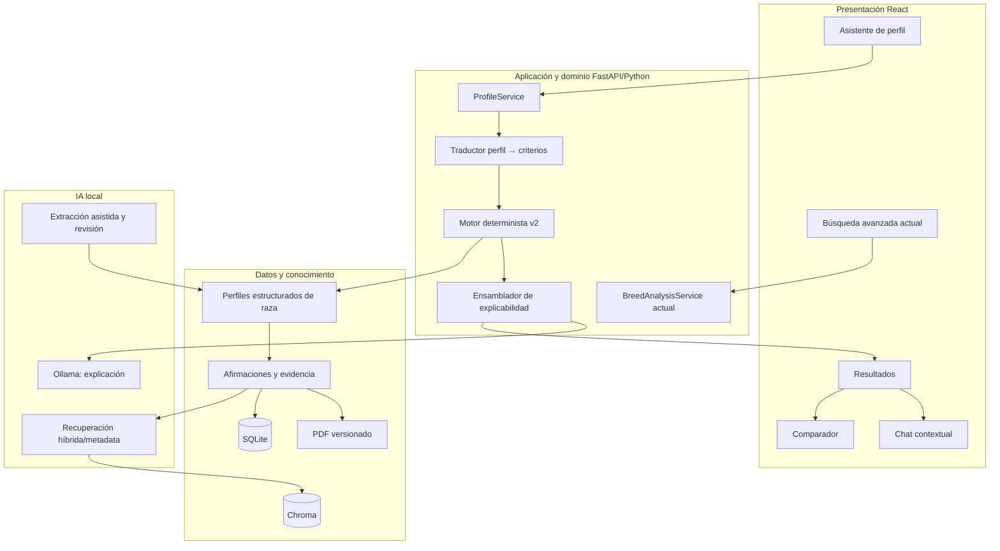
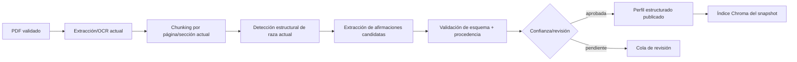

# Exploración y rediseño de K9 BreedMatch

**Estado:** análisis previo; no autoriza implementación  
**Fecha:** 2026-11-02  
**Principio rector:** valor para el usuario > claridad de la recomendación > evidencia verificable > complejidad tecnológica

## 1. Resumen ejecutivo

K9 BreedMatch ya tiene gran parte de la infraestructura difícil de un recomendador explicable: un flujo principal distinto del chat, descubrimiento dinámico de razas desde el corpus, recuperación semántica filtrable, resultados `match` / `mismatch` / `not_documented`, puntuación determinista, umbral de cobertura, citas por página, abstención, persistencia, trazas, retroalimentación y una narrativa de Ollama que no modifica el ranking.

La evolución no debe reemplazar ese núcleo. Debe introducir una capa de decisión orientada al cazador entre la interfaz y el análisis documental actual:

1. recopilar un perfil breve en lenguaje cotidiano;
2. distinguir restricciones, preferencias y datos desconocidos;
3. transformar ese perfil en atributos normalizados y documentables;
4. consultar perfiles de raza estructurados con procedencia;
5. calcular un ranking multidimensional reproducible;
6. recuperar evidencia para explicar cada resultado;
7. permitir que Ollama redacte, pero nunca invente atributos, citas o puntuaciones.

El MVP recomendado no incluye extracción automática completa ni un chat contextual nuevo. Primero debe validar que el cuestionario, el modelo de criterios y el ranking determinista producen decisiones útiles con un pequeño conjunto de perfiles revisados por expertos. La extracción asistida y el chat se incorporan después.

## 2. Alcance y método

Se inspeccionaron manifiestos, configuración, frontend, API, dominio, servicios de aplicación, adaptadores de SQLite/Chroma/Ollama, ingesta, extracción, clasificación, pruebas, especificaciones OpenSpec y documentación de arquitectura. No se modificó la aplicación ni se ejecutaron migraciones.

La exploración encontró 137 pruebas backend y 39 casos o suites frontend/e2e detectables por búsqueda estática. Estas cifras describen inventario, no un resultado de ejecución de la suite.

## 3. Diagnóstico actual

### 3.1 Arquitectura verificada

| Área | Implementación encontrada | Diagnóstico |
|---|---|---|
| Web | React 19, TypeScript, Vite; navegación hash; vistas BreedMatch, Consultar, Biblioteca, Administración y Sistema | Ligera, accesible y sin framework de estado innecesario. BreedMatch ya es la ruta inicial. |
| API | FastAPI bajo `/api/v1`, contratos Pydantic y sobre de errores estable | Buen límite para evolucionar contratos de perfil y recomendación con versionado. |
| Dominio/aplicación | Dataclasses, servicios de caso de uso, composición explícita y puertos | Separación adecuada para introducir perfil, reglas y ranking sin microservicios. |
| Persistencia | SQLite para documentos, versiones, páginas, fragmentos, snapshots, análisis, hallazgos, citas, cachés, trazas y feedback | Reutilizable. No existe todavía un perfil estructurado multidimensional de raza/cazador. |
| Vector store | Chroma persistente, una colección por generación/snapshot | Reutilizable para evidencia; no debe ser la fuente del puntaje. |
| Modelos locales | Ollama: modelos simple/complex/fallback y `nomic-embed-text`, 768 dimensiones | Satisface ejecución local. El enrutador y fallback ya están instrumentados. |
| Ingesta | Worker persistente; validación PDF; PyMuPDF; OCR selectivo con Tesseract; chunking por página/sección; embeddings; validación y publicación atómica | Base sólida. La extracción actual clasifica metadatos limitados; no construye perfiles completos de recomendación. |
| RAG | Recuperación vectorial con filtros de documento, categoría, raza y sección; selección, suficiencia, reformulación acotada y generación verificada | Adecuado para explicación y chat documental. No hay búsqueda léxica/híbrida explícita ni reranker dedicado. |
| Evidencia | Fragmento, documento/versión, página física, etiqueta impresa, snapshot y estado de fuente | Trazabilidad fuerte y reutilizable. |
| Observabilidad/evaluación | Trazas por etapas, métricas de capas, feedback, datasets, gates y ejecuciones versionadas | Debe extenderse con métricas de recomendación y UX. |

### 3.2 Flujo actual de BreedMatch

```mermaid
flowchart LR
  U[Usuario elige etiquetas técnicas] --> UI[BreedMatchView]
  UI --> API[POST /api/v1/breed-analyses]
  API --> D[Descubre o resuelve razas]
  D --> R[Recupera evidencia por raza y criterio]
  R --> M[DeterministicBreedMatcher]
  M --> O[match / mismatch / not_documented]
  O --> S[Puntaje = peso coincidente / peso documentado]
  S --> L[Ollama redacta síntesis verificada]
  L --> V[Tabla, evidencia, citas y limitaciones]
```



La interfaz ofrece función de caza, manto y aptitud de trabajo; permite marcar opciones como imprescindibles (peso 2), limitar razas y mostrar tabla, cobertura, fórmula, evidencia y ficha documental con fotografía si el PDF la contiene.

### 3.3 Fortalezas que cambian la estrategia

- El LLM ya está separado del cálculo y sus fallos degradan la narrativa, no el informe.
- Los valores no documentados reducen cobertura y no se convierten en coincidencias.
- El sistema puede mostrar menos resultados o abstenerse.
- Las razas no dependen de una lista cerrada: se descubren desde encabezados y se publican con el snapshot.
- Las versiones y citas preservan el contexto histórico.
- La ingesta no publica índices parciales.
- La interfaz y pruebas ya contemplan accesibilidad, móvil y límites API.

### 3.4 Limitaciones críticas

1. **La entrada sigue siendo taxonómica.** “Rastro”, “muestra” y “cobro” exigen conocimiento previo y no modelan la situación cotidiana del cazador.
2. **El dominio del perfil es demasiado plano.** `BreedAnalysisProfile` sólo contiene criterios `key/value/weight`, razas y documentos.
3. **La semántica de coincidencia es débil.** El matcher usa presencia de subcadena y una heurística local de negación. Es útil para el MVP académico actual, pero insuficiente para terreno, experiencia, tiempo, cuidados y clima.
4. **Puntaje condicional a lo documentado.** `matches/documented` evita penalizar ausencias, pero puede favorecer a una raza con poca evidencia positiva. La cobertura visible mitiga, no resuelve, el problema.
5. **No hay distinción de restricciones y preferencias.** “No puedo darle más de una hora de ejercicio” no debe comportarse como una preferencia de peso 2.
6. **No hay perfil estructurado de raza por atributo.** La ficha actual devuelve secciones documentales, no afirmaciones normalizadas con confianza y procedencia.
7. **No hay contradicción multifuente explícita.** La lógica actual considera evidencia recuperada, pero no conserva un estado de consenso/conflicto por atributo.
8. **La recuperación es principalmente vectorial con filtros.** Para valores controlados y nombres, una capa léxica/metadata puede mejorar precisión y auditabilidad.
9. **El chat no recibe el perfil ni el resultado determinista como contexto de sesión de recomendación.**
10. **Las métricas existentes evalúan RAG/capas, no utilidad decisional ni acuerdo con especialistas.**

## 4. Propuesta de valor

> K9 BreedMatch ayuda al cazador a definir qué perro necesita, compara razas mediante reglas reproducibles y explica cada recomendación con evidencia local verificable, incluyendo incompatibilidades, incertidumbre y datos ausentes.

La promesa no debe ser “encontrar la raza perfecta”. Debe ser “reducir opciones y hacer visibles los compromisos con evidencia”.

## 5. Experiencia objetivo

### 5.1 Flujo propuesto



### 5.2 Preguntas indispensables y opcionales

| Prioridad | Pregunta | Razón |
|---|---|---|
| Obligatoria | Especie o grupo de presas | Define la tarea de caza; admite selección múltiple. |
| Obligatoria | Qué debe hacer el perro | Evita inferir modalidad sólo desde la presa; cada opción necesita definición simple. |
| Obligatoria | Terreno principal | Afecta el contexto funcional. |
| Obligatoria | Experiencia con perros de trabajo | Necesaria para valorar facilidad del propietario. |
| Obligatoria | Tiempo habitual de ejercicio/entrenamiento | Convierte “disponibilidad” en una restricción útil. |
| Condicional | Agua/humedales y clima extremo | Preguntar sólo si el terreno/modalidad lo vuelve relevante. |
| Condicional | Espacio y convivencia | Relevante si se pretende recomendar mantenimiento; no usar como proxy absoluto de bienestar. |
| Opcional | Frecuencia de caza | Importa, pero no sustituye el ejercicio cotidiano. |
| Opcional | Preferencias de manto/cuidados/tamaño | Preferencias, salvo restricción explícita. |
| Opcional | Razas a incluir/excluir | Mantiene el comparador avanzado actual. |

“Modalidad pendiente” en el perfil de ejemplo no permite aún evaluar el criterio dominante de compatibilidad. El sistema debe preguntar qué trabajo espera del perro y explicar rastreo, rastro de sangre, muestra, cobro, levantamiento y agua. El tiempo no especificado también debe preguntarse antes de puntuar disponibilidad. No corresponde recomendar una raza todavía.

### 5.3 Wireframes textuales

```text
┌─────────────────────────────────────────────────────────────┐
│ K9 BreedMatch                         Paso 2 de 5  ●●○○○    │
│ ¿Qué espera que haga el perro durante la caza?              │
│                                                             │
│ [ Seguir un rastro ]  [ Localizar una pieza herida ]        │
│ [ Quedarse señalando ] [ Levantar piezas ] [ Cobrar ]       │
│ [ Trabajar en agua ]                                        │
│                                                             │
│ (?) “Muestra”: el perro localiza y señala sin levantar...    │
│                                                             │
│ [Atrás]                                      [Continuar]     │
│                                    Guardado sólo en este equipo│
└─────────────────────────────────────────────────────────────┘
```

```text
┌─────────────────────────────────────────────────────────────┐
│ Tu perfil                                                    │
│ Venado · monte denso · rastreo · principiante · ocasional   │
│ Tiempo diario: sin responder [Completar]              [Editar]│
├─────────────────────────────────────────────────────────────┤
│ 1  Raza A             Compatibilidad documentada: alta*     │
│ ✓ Función y terreno   ! Entrenamiento exigente              │
│ Evidencia: 4/5 dimensiones · 2 fuentes · existe conflicto   │
│ [Por qué] [Fuentes] [Comparar] [Preguntar]                  │
├─────────────────────────────────────────────────────────────┤
│ *Nivel, no falsa precisión; pesos y fórmula disponibles.     │
└─────────────────────────────────────────────────────────────┘
```

```text
┌────────────────────── Comparar ──────────────────────────────┐
│ Dimensión          Raza A          Raza B          Raza C    │
│ Modalidad          Coincide        Coincide        Desconocido│
│ Terreno            Parcial         Coincide        Contradice│
│ Propietario        Exigente        Moderada        Desconocido│
│ Actividad          Alta            Media           Alta       │
│ Cobertura          4/5             5/5             3/5        │
│ [Abrir evidencia de cada celda]                              │
└──────────────────────────────────────────────────────────────┘
```

## 6. Arquitectura objetivo



No se recomiendan microservicios ni otra base de datos. Las nuevas responsabilidades pueden ser módulos y tablas dentro del backend actual. Chroma continúa como índice derivado; SQLite conserva el estado autoritativo y la procedencia.

## 7. Modelo conceptual de datos

El siguiente modelo es conceptual; no es una propuesta de migración aprobada.

```text
HunterProfile
  id, schema_version, created_at
  answers[]: question_key, value(s), importance, source=user
  constraints[]: rule_key, operator, threshold
  unresolved_questions[]

BreedProfile
  breed_id/canonical_name, snapshot_id, profile_version, review_status
  assertions[]

BreedAssertion
  attribute_key                 # prey.deer, modality.tracking, terrain.dense...
  normalized_value             # supported / limited / level / range
  polarity                     # supports / contradicts
  confidence                   # extracción/revisión, no afinidad
  evidence_status              # documented / conflicting / unknown
  evidence_refs[]
  extraction_method            # rule / model-assisted / human
  reviewed_by, reviewed_at

EvidenceRef
  fragment_id, document_id, version_id, snapshot_id
  physical_page, printed_page_label, excerpt_hash
```

Una ausencia de `BreedAssertion` significa “desconocido”, nunca “incompatible”. Una contradicción requiere afirmaciones explícitas con procedencia; no se resuelve silenciosamente por mayoría.

## 8. Motor determinista de recomendación

### 8.1 Separación de decisiones

- **Filtros duros:** sólo restricciones explícitas, verificables y acordadas con expertos. Ejemplo: una modalidad obligatoria que la evidencia contradice claramente. Un dato ausente nunca filtra.
- **Penalizaciones:** incompatibilidad documentada o condición que excede un límite explícito del usuario.
- **Preferencias:** influyen en el ranking, pero no eliminan.
- **Desconocidos:** reducen cobertura/confianza; no suman ni restan afinidad.
- **Conflictos:** reducen confianza y se muestran; sólo una regla versionada y revisada puede resolverlos.

### 8.2 Fórmula propuesta

Para cada dimensión `d`, con peso de política `w_d`:

```text
observed_d ∈ {0,1}                   hay evidencia resoluble
compatibility_d ∈ [0,1]             regla determinista por atributo normalizado
penalty_d ∈ [0,1]                   sólo incompatibilidad documentada

weighted_match = Σ(w_d × observed_d × compatibility_d)
documented_mass = Σ(w_d × observed_d)
coverage = documented_mass / Σ(w_d)
base_score = weighted_match / documented_mass       si supera cobertura mínima
final_score = max(0, base_score - Σ penalizaciones versionadas)
```

Debe mostrarse por separado:

- compatibilidad calculada;
- cobertura de evidencia;
- número/diversidad de fuentes;
- estado de conflicto;
- penalizaciones y motivo.

No se debe mostrar un porcentaje único en el MVP hasta validar que usuarios lo interpretan correctamente. Son preferibles bandas (“alta/moderada/baja compatibilidad documentada”) derivadas de umbrales versionados, acompañadas por la fórmula detallada.

Los pesos iniciales 30/25/20/15/10 pueden ser una política experimental `recommendation-v2-draft`, no un hecho científico. Deben calibrarse con perfiles etiquetados por varios especialistas y análisis de sensibilidad. Si una dimensión está completamente sin documentar, no aumenta el score; sí reduce cobertura.

### 8.3 Perfil de ejemplo

Con venado, monte denso, principiante, actividad ocasional, modalidad desconocida y tiempo desconocido:

- se conoce presa, terreno, experiencia y frecuencia;
- faltan modalidad y disponibilidad cotidiana;
- “ocasional” describe caza, no ejercicio/entrenamiento;
- falta confirmar si “venado” implica rastreo, rastro de animal herido u otra tarea;
- el sistema debe hacer dos preguntas adaptativas antes de calcular;
- no hay base para inventar puntuaciones, razas candidatas ni citas.

## 9. RAG y conocimiento estructurado

### 9.1 Pipeline propuesto



La extracción puede usar reglas primero y Ollama para producir JSON candidato, siempre como contenido no confiable. Debe validarse contra un esquema cerrado, limitar contexto/salida, ignorar instrucciones del documento y exigir `evidence_ref` válido. El modelo no publica directamente.

### 9.2 Duplicados y ediciones

- conservar `content_hash` y la lógica actual de versión documental;
- identificar afirmaciones por raza + atributo + valor normalizado + evidencia/version;
- no sobrescribir una edición anterior: publicar un nuevo perfil ligado al snapshot;
- detectar equivalencias entre fragmentos por hash y procedencia;
- retirar afirmaciones sólo al retirar su fuente o aprobar una resolución explícita;
- mostrar conflictos entre ediciones/autores en lugar de fusionarlos sin rastro.

### 9.3 Recuperación recomendada

| Estrategia | Uso recomendado |
|---|---|
| Metadata/atributo | Primera opción para obtener afirmaciones de una raza y dimensión. Exacta y auditable. |
| Léxica | Nombres, términos controlados, negaciones y citas concretas. Puede iniciarse con SQLite FTS sólo si un spike demuestra necesidad. |
| Vectorial actual | Preguntas abiertas, sinónimos y explicación contextual. |
| Híbrida | Fusión determinista de metadata/léxica/vectorial para explicación; no para score bruto. |
| Reranking | Posponer. Sólo justificar si la evaluación muestra errores top-k que metadata y fusión no resuelven. |

No se recomienda añadir ahora otra base o framework. Primero deben medirse los fallos de recuperación del índice actual.

## 10. Chat contextual

El chat debe recibir un paquete de contexto inmutable:

```text
profile_snapshot
recommendation_policy_version
ranked_results + dimension_breakdown
selected_breeds
allowed_evidence_ids
known_unknowns + conflicts + limitations
```

Las respuestas deben diferenciar:

1. **Evidencia bibliográfica:** afirmación + fuente/página.
2. **Inferencia del algoritmo:** regla y entradas que la produjeron.
3. **Explicación generada:** redacción de Ollama sobre 1 y 2.

El chat puede explicar o comparar; no puede recalcular silenciosamente. Un cambio de preferencias debe crear una nueva evaluación visible.

## 11. Clasificación de componentes

| Acción | Componentes |
|---|---|
| Conservar | FastAPI, React/Vite, Ollama, SQLite, Chroma, worker, snapshots, validación PDF, OCR, citas, guardarraíles, trazas, feedback, admin y biblioteca. |
| Reutilizar | `BreedAnalysisService`, `DeterministicBreedMatcher` como baseline, `SnapshotRetriever`, registro dinámico, ficha/fotos, API de análisis, componentes de evidencia y tablas. |
| Refactorizar | Perfil plano, criterio `key/value`, matcher por subcadena, construcción de consultas por criterio, presentación de score único. |
| Extender | Contratos API versionados, telemetría, datasets, perfil de raza, procedencia, conflictos, comparador y contexto de chat. |
| Crear | Asistente progresivo, traductor de perfil, modelo de afirmaciones, política v2, revisión de extracción y evaluación experta/UX. |
| Eliminar | Nada en esta fase. La vista avanzada actual debe conservarse como alternativa. |

## 12. Roadmap incremental

### Fase 0 — Validación de dominio

- Taller con especialistas: glosario, preguntas, restricciones reales y rúbrica.
- Dataset pequeño de perfiles de cazador con evaluaciones independientes.
- Spike offline sobre cobertura de atributos en el corpus actual.

**Salida:** taxonomía y política borrador; sin UI productiva ni migración.

### Fase 1 — UX del perfil + traducción explícita

- Asistente de 5 pasos, resumen editable y ayuda contextual.
- Mantener API/matcher actual detrás de un adaptador sólo para criterios soportados.
- No mostrar resultados para dimensiones que el backend aún no representa.

### Fase 2 — Perfiles estructurados revisados

- Modelo de afirmaciones/procedencia y flujo de revisión.
- Poblar una muestra representativa antes de automatizar extracción.
- Medir cobertura y conflicto.

### Fase 3 — Motor v2 y resultados

- Restricciones/preferencias/desconocidos.
- Ranking multidimensional, nivel de evidencia y top máximo de tres.
- Comparador de 2–3 razas.

### Fase 4 — Integración RAG

- Recuperación por raza/atributo y explicación con citas.
- Evaluar fusión léxica/vectorial; reranking sólo con evidencia de necesidad.

### Fase 5 — Chat contextual

- Contexto inmutable de recomendación.
- Preguntas sobre razones, diferencias, cuidados y datos ausentes.

### Fase 6 — Extracción asistida y evaluación continua

- Candidatos de afirmación generados localmente, revisión y publicación por snapshot.
- Gates de ranking, RAG, citas y UX.

Este orden mueve el modelo estructurado antes del ranking definitivo: una interfaz atractiva no puede sostener dimensiones que el conocimiento todavía no representa.

## 13. Evaluación

| Dimensión | Métrica | Necesita etiquetas/humanos |
|---|---|---|
| Ranking | acuerdo top-k con especialistas, nDCG, estabilidad, sensibilidad a pesos, reproducibilidad | Sí, perfiles y juicios expertos |
| Reglas | exactitud de cada dimensión, tasa de filtros falsos, tratamiento de desconocidos | Sí |
| RAG | Recall@k, MRR/nDCG, precisión por atributo, suficiencia | Sí, qrels por raza/atributo |
| Citas | página correcta, entailment afirmación-cita, citas inexistentes | Revisión humana parcial; existencia automática |
| Fidelidad | afirmaciones soportadas / afirmaciones totales | Humana o juez validado, nunca sólo autoevaluación del mismo modelo |
| Cobertura | atributos documentados por raza/dimensión/fuente | Automática desde afirmaciones aprobadas |
| UX | finalización, abandono por paso, tiempo, retrocesos, comprensión, utilidad | Analítica local + estudio humano |
| Operación | latencia p50/p95, memoria, abstención, errores, uso de fallback | Automática |

La validación experta debe medir acuerdo interevaluador; el desacuerdo no debe ocultarse bajo una “verdad” única.

## 14. Riesgos y mitigaciones

| Riesgo | Mitigación |
|---|---|
| Corpus insuficiente para cuidados/propietario | Auditoría de cobertura antes de ampliar UI; mostrar “no documentado”; incorporar fuentes legales versionadas. |
| Falsa precisión | Bandas + cobertura + desglose; porcentajes sólo tras validación. |
| Extracción LLM incorrecta | JSON cerrado, procedencia obligatoria, revisión, publicación atómica y pruebas adversariales. |
| Prompt injection en PDF | Tratar texto como datos, no instrucciones; prompts delimitados, salida validada, sin herramientas ni publicación directa. |
| Sesgo de pesos | Política versionada, expertos múltiples, análisis de sensibilidad y feedback separado de evidencia. |
| Evidencia contradictoria | Estado `conflicting`, fuentes visibles y reglas explícitas; no resolver por silencio. |
| Rendimiento en 16 GB | Worker de concurrencia 1, ingesta fuera de consulta, embeddings cacheados, modelos pequeños y contexto acotado. |
| Regresión del producto actual | Mantener búsqueda avanzada y contratos v1; añadir v2 de forma compatible y tests de regresión. |
| Fotografías/derechos | Mostrar sólo imágenes extraídas de fuentes legítimas ya gestionadas y su procedencia. |

## 15. Trazabilidad de cambios propuestos

| Funcionalidad | Módulos actuales afectados/reutilizados |
|---|---|
| Asistente de perfil | `frontend/src/features/breedmatch/BreedMatchView.tsx`, `frontend/src/api/types.ts`, `frontend/src/api/client.ts` |
| Resultados y comparador | `BreedMatchView.tsx`, componentes de citas, `BreedProfileDialog.tsx` |
| Contrato v2 | `presentation/api.py`, `domain/models.py` |
| Traducción del perfil | nuevo módulo de aplicación junto a `application/breed_analysis.py` |
| Ranking determinista v2 | evolución paralela de `application/breed_match.py`; conservar v1 para compatibilidad |
| Perfil estructurado | `infrastructure/sqlite.py`, repositorios y API de perfiles; requiere propuesta/migración posterior |
| Extracción de atributos | `application/ingestion.py`, `infrastructure/structuring.py`, `domain/breed_vocabulary.py` |
| Recuperación por atributo | `application/indexing.py`, `application/query.py`, metadatos de `vector_index.py` |
| Explicación Ollama | `application/breed_analysis.py`, `generation.py`, guardarraíles |
| Chat contextual | `features/chat/*`, `application/query_service.py`, contratos de conversación |
| Métricas/evaluación | `application/observability.py`, `evaluation/*`, `docs/evaluation/*` |
| Seguridad documental | validadores existentes en `application/documents.py`, ingesta y guardarraíles |

## 16. Matriz de recomendaciones técnicas

| Recomendación | Motivo/beneficio | Complejidad | Dependencias/impacto | Alternativa |
|---|---|---:|---|---|
| Mantener monolito modular | La escala local no justifica red distribuida | Baja | Ninguna; preserva composición | Microservicios: descartados |
| Añadir conocimiento estructurado con procedencia | El score necesita atributos, no texto libre | Alta | Dominio, persistencia, ingesta, revisión | Calcular desde chunks en cada consulta: menos reproducible |
| Versionar política v2 junto a v1 | Migración segura y comparación A/B offline | Media | API, dominio, evaluación | Reemplazo directo: alto riesgo |
| Bandas + cobertura | Evita falsa precisión y comunica incertidumbre | Media | Política UX y thresholds | Porcentaje único: ambiguo |
| Metadata primero, vectores para explicación | Mayor auditabilidad | Media | Perfiles aprobados | Embedding como score: opaco |
| Extracción asistida con revisión | Escala sin delegar verdad al LLM | Alta | UI/admin de revisión | Manual total o autopublicación; ambos extremos son peores |
| Preguntas adaptativas | Reduce longitud sin omitir datos decisivos | Media | Reglas de completitud | Formulario largo fijo |

## 17. Criterios de aceptación verificables del MVP

1. Un usuario puede completar el perfil esencial en cinco pasos o menos y volver a cualquier paso.
2. Cada término de modalidad tiene explicación en lenguaje no técnico y es accesible por teclado/lector.
3. El sistema no calcula recomendación si falta un dato marcado como decisivo; formula una pregunta concreta.
4. Cada resultado muestra desglose por dimensión, cobertura y al menos una cita por coincidencia documentada.
5. Un atributo desconocido nunca se transforma en coincidencia o incompatibilidad.
6. Una incompatibilidad sólo filtra si la restricción es explícita y existe evidencia aprobada.
7. El mismo perfil, snapshot y versión de política producen idéntico ranking.
8. Ollama desactivado conserva ranking, hallazgos, citas y limitaciones; sólo pierde narrativa.
9. Si no hay evidencia suficiente, se muestran menos de tres resultados o ninguno con motivo explícito.
10. El comparador admite 2–3 razas y enlaza cada celda documentada a su fuente/página.
11. La vista avanzada y funcionalidades actuales siguen disponibles.
12. Las pruebas responsive, WCAG, API, ranking, abstención y citas pasan en la Mac objetivo.

## 18. Preguntas abiertas y decisiones pendientes

1. ¿Qué fuentes documentan de forma legítima y suficiente actividad, entrenamiento, mantenimiento, clima y facilidad para principiantes?
2. ¿Qué significa exactamente “facilidad para el propietario” y cómo evitar juicios antropomórficos o absolutos?
3. ¿Qué restricciones pueden ser realmente duras según especialistas?
4. ¿Debe el perfil persistirse o ser efímero/local por defecto?
5. ¿Qué especialistas participarán y cómo se resolverá su desacuerdo?
6. ¿Qué umbral mínimo de cobertura permite mostrar una banda de compatibilidad?
7. ¿La presa debe modelarse por especie, grupo o relación presa-modalidad?
8. ¿Cómo se expresan rangos de tiempo y actividad sin fingir precisión documental?
9. ¿Qué atributos merecen revisión humana obligatoria antes de publicación?
10. ¿Se requiere SQLite FTS, o los perfiles + filtros actuales bastan según la evaluación?

## 19. MVP recomendado

El MVP debe probar la decisión, no toda la automatización:

- asistente breve con presa, modalidad, terreno, experiencia y tiempo;
- glosario contextual;
- 2–3 dimensiones adicionales sólo si el corpus auditado las soporta;
- perfiles estructurados de una muestra de razas, creados/revisados manualmente con procedencia;
- motor determinista v2 con desconocidos y cobertura;
- máximo tres resultados, comparador y citas;
- narrativa local opcional, sin autoridad sobre ranking;
- búsqueda avanzada actual intacta;
- dataset experto pequeño y pruebas de comprensión con usuarios.

Quedan fuera del MVP: autopublicación de extracción LLM, reranker nuevo, base adicional, microservicios, personalización aprendida, recomendación sanitaria y catálogo comercial.

## 20. Próximo punto de decisión

Antes de una propuesta OpenSpec de implementación conviene aprobar tres elementos: taxonomía del perfil, política determinista v2 y alcance del corpus. Con esas decisiones se puede crear un cambio dividido en entregas compatibles, con migraciones y contratos explícitos. Hasta entonces, implementar el wizard completo generaría una interfaz que promete criterios todavía no respaldados por conocimiento estructurado.
